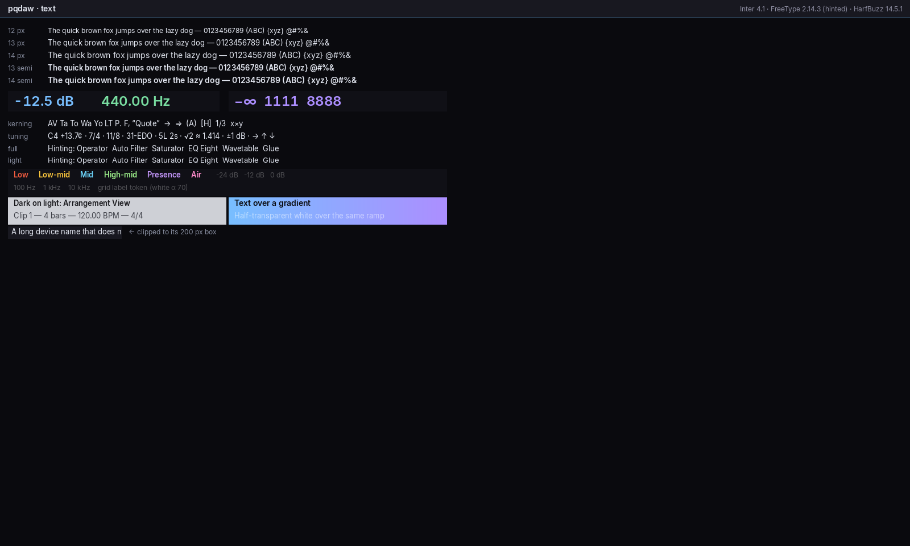
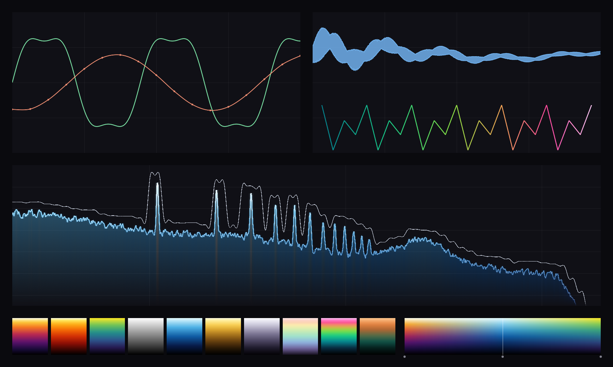

# M0 review (Foundation)

Reviewer: independent M0 review agent, 2026-10-20, `main` at `afc4b2d`.

What I ran (worktree, i7-11700F + RTX 3060 Ti, machine shared with other agents):
- `./scripts/build.ps1 -Preset release` and `./scripts/build.ps1` (dev), both from a clean build dir: 0 compiler warnings (only doctest's own CMake deprecation notice), **11/11 CTest suites pass in both**.
- `pqdaw --screenshot {test-pattern,text,lines} … --size 1600x960`, zoomed crops, contrast-ratio calculations.
- `pqdaw` (idle), `pqdaw --animate`, `pqdaw --scene lines --animate` for 5 s each (CPU time from the process), `pqdaw --window-selftest` ×5 (once with `PQ_VK_VALIDATION=1`: 0 validation errors).
- I did **not** run `--sine` (it plays a tone on the user's speakers); the audio findings come from reading our code and RtAudio 6.0.1's WASAPI source in `build/release/_deps/rtaudio-src/RtAudio.cpp`.

## Summary verdict

M0 is solid engineering where it matters most. I found **no correctness bug** in the lock-free primitives (SPSC, Vyukov MPSC, QSBR epoch reclaimer: orderings, wraparound, and the offline/online fence pairing all check out), the allocation trap does what it claims within its documented `/MT` limits, the fast-math bounds are tested by dense sweeps against `double`, and the tempo-map ½-sample test is real (an independent Gauss–Legendre reference over a 10 h, 588-point map). Both presets build clean and pass. The weak spots are elsewhere. (1) **Audio I/O is the least finished part and is marked done.** T0.6 asked for WASAPI exclusive + ASIO. What shipped is RtAudio's WASAPI shared mode, which adds its own ring buffer and three copies, delivers callbacks in bursts (a 20.8 ms gap at a 5.3 ms period was logged), and cannot see output underruns, so "0 xruns" proves nothing. (2) **The renderer can't do what SPEC §11 promises at DAW scale:** every damage event is a full clear and redraw, there is no HiDPI scaling at all, glyph uploads stall the GPU, and textures can't be updated or destroyed. (3) **The draw list is a PQ Meter port target, not yet a widget toolkit base.** There are no strokes, borders, circles, arcs, triangles or public convex fill, and the "bilinear" 4-corner gradient has a visible diagonal crease. Text quality is good: crisp hinted Inter, even spacing, good contrast for body text. Signal-display lines look like PQ Meter. Nothing in M0 shows the Ableton dark-grey chrome yet (that's T3.2), so the aesthetic verdict on "Ableton-quality" is still open. The foundation can carry it if the High items below are fixed before T3.1/T3.2 harden their APIs.

## Findings

Sorted by severity. No Critical findings.

| # | Sev | Where | What's wrong | Why it matters | Suggested fix |
|---|---|---|---|---|---|
| H1 | High | `src/engine/src/rtaudio_device.cpp:127-195`, RtAudio `RtAudio.cpp:5626-6150` (`RtApiWasapi::wasapiThread`), TASKS T0.6 | T0.6 is `[x]` but WASAPI **exclusive** is unsupported (returns `Unsupported`) and ASIO is off by default (Q12). RtAudio's WASAPI loop runs our callback when its own `WasapiBuffer` ring (line 4418) has room, not on the device event. So callbacks come in bursts (orchestrator saw 20.8 ms max gap at 5.3 ms period). Each block is copied three times: `convertBuffer` interleave, resampler `memcpy` pass-through, `pushBuffer` into the ring. Output underflow is never reported, so `--sine`'s "0 xruns" holds by construction. | Latency and glitch-detection are core DAW properties. Every later RT measurement (hot swap click tests, Operator CPU at 64 voices) runs on top of an I/O layer that can't report a dropout. The task's acceptance criterion is met vacuously. | Re-open T0.6 as partially met. Schedule an own event-driven WASAPI backend behind `AudioDevice` (exclusive + shared, `IAudioClient3` low-latency shared periods, underrun detection via `GetCurrentPadding` and `IAudioClock` position vs frames written). Decide ASIO (Q12 B: clean-room IASIO host). See T0.6-fix1/fix2. |
| H2 | High | `src/ui/src/window.cpp:18`, `src/app/src/commands.cpp:102`, `src/ui/include/pq/ui/text.h:36-41` | No HiDPI support. The window asks for `SDL_WINDOW_HIGH_PIXEL_DENSITY`, but nothing reads the display scale: font sizes are fixed 12/13/14 px, geometry is in device pixels, and `DISPLAY_SCALE_CHANGED` only triggers a redraw. No task in TASKS.md covers it. | At 125–200% Windows scaling (common on 1440p/4K) the whole UI renders at 50–80% of its intended physical size. T3.1 (layout with "integer-pixel snapping") and T3.2 (font roles) are being built now and will bake in 1× assumptions. Retrofitting is far more expensive than designing for it. | Before T3.1/T3.2 land: a `UiScale` (from `SDL_GetWindowDisplayScale`) in the UI context. Layout in logical px, snapped to device px. Font roles map to `round(13·scale)`-px hinted fonts (still integer sizes, as SPEC §11 requires). Line widths/feathers stay in device px. Re-render on scale change. T0.7-fix3. |
| H3 | High | `src/ui/src/window.cpp:290` (`loadOp = CLEAR`), `src/ui/include/pq/ui/damage.h:6`, `src/app/src/commands.cpp:62-87` | "Damage-driven redraw" only means "redraw everything when anything is damaged". The swapchain image is cleared and the whole draw list is rebuilt and redrawn every frame. `Damage` keeps a union rect that nothing consumes. | SPEC §11 asks for dirty-rect redraw and an idle UI at about 0%. In M3 a moving playhead, meters and a scope repaint at 60–144 Hz. With a 5–10k-widget arrangement, full rebuild + redraw every frame costs milliseconds of UI-thread CPU per frame for a 2-pixel playhead. T3.1's acceptance ("toggling one widget damages exactly its rect") will test a rect nobody uses. | Render into a persistent offscreen colour target (LOAD, not CLEAR). Re-record only the commands whose bounds intersect the damage (scissor = damage rect), then copy/blit to the swapchain image (or use `VK_KHR_incremental_present`). Also cache per-widget draw-list chunks so an unchanged subtree isn't rebuilt. T0.7-fix1. |
| M1 | Medium | `src/ui/include/pq/ui/draw_list.h:154-166`, `:192` | No primitives a widget toolkit needs. There is no rect/rounded-rect **stroke** (borders), no circle/arc (knobs, modulation rings), no triangle (disclosure arrows, play button), and no public convex polygon fill (`addConvexAA` is private). There is no pixel-snapped hairline either. The only line primitive is PQ Meter's ribbon with a 0.75 px feather each side, so a 1 px separator comes out as a soft 2.5 px smear. | T3.2's knob, toggle, dropdown and scrollbar will either hand-roll geometry in widget code or draw blurry outlines. Ableton's look is mostly crisp 1 px edges and flat fills, and that's exactly the missing piece. | Add `addRectStroke` (pixel-snapped, made of 4 rects), `addRoundedRectStroke` (AA inner and outer ring), public `addConvexPolyFilled`, `addCircleFilled/Stroke`, `addArcStroke` (on the ribbon or AA ring), `addTriangleFilled`, `addHLine/addVLine` (snapped, unfeathered). Golden scene `primitives`. T0.7-fix2. |
| M2 | Medium | `src/ui/include/pq/ui/draw_list.h:157`, `src/ui/src/draw_list.cpp:326-329` | `addRectFilledMultiColor` is documented as a "bilinear 4-corner gradient", but it's one quad split into two Gouraud triangles. The result has a visible diagonal crease from the top-left to the bottom-right corner (see `M0/4corner-gradient-crease-3x.png`). | The header documents something the code doesn't do. 2-colour linear gradients are unaffected, but any real 4-colour use (pads, XY controls, colour pickers) shows the seam. | Emit a centre vertex with the average colour (4-triangle fan; bilinear at the centre, much smaller error), or subdivide to N×N for true bilinear. At minimum, fix the comment. Part of T0.7-fix2. |
| M3 | Medium | `src/ui/src/renderer.cpp:324-374` (`vkDeviceWaitIdle` at :330, then a blocking `submitAndWait`) | Every frame that rasterises a new glyph stalls the CPU until the GPU is idle, then does a second blocking submit. ASCII is pre-warmed, but ¢, ≈, →, accidentals (Q16 fallback), typed text, and new sizes (zoom, DPI change) all hit this. The atlas is also one 1024² **RGBA** page (glyphs only need 8-bit coverage, so it uses 4× the memory and bandwidth) with no eviction. When it fills, glyphs are dropped silently (`text.cpp:131`, `stats.atlasFull`). | Visible hitches while typing or when a new symbol appears. After H2, 2 weights × 4 roles × several scales will fill the page. | Per-frame staging ring; record the atlas copy and barriers into the frame's own command buffer (no waits); R8 glyph pages separate from the RGBA sprite page; multiple pages with LRU eviction by frame stamp; fail loudly (log once) when full. T0.8-fix1. |
| M4 | Medium | `src/ui/src/renderer.cpp:204-298`, `renderer.h:36` | Textures are create-only: blocking `submitAndWait` upload, at most 256, and no `destroyTexture` or `updateTexture`. | Spectrogram (SPEC §11.1), waveform overviews and clip thumbnails need streaming column/tile updates and lifetime management. Today the only way is to create a new texture per frame until the table is full. | `updateTexture(id, rect, bytes)` through the same per-frame staging ring as M3; `destroyTexture` deferred by frame fence; slot free list. T0.7-fix4. |
| M5 | Medium | `tests/ui/test_render.cpp:172-174` | The golden comparison allows 0.1% of pixels (384 px at 800×480) to differ by **any** amount. | A dropped glyph (about 60–100 px at 13 px), a missing marker dot, or a 1 px shift of a thin trace can all pass. Since the goldens were generated by the same code, this check is the only thing guarding the 👁 tasks against regressions. | Keep the per-vendor allowance, but cap outlier magnitude (e.g. ≤ 24/255) and require outliers to be isolated (no 2×2 cluster over tolerance). Report the bounding box of failures. T0.7-fix5. |
| M6 | Medium | `src/ui/include/pq/ui/lines.h:14-15`, PROGRESS T0.8+T0.9 entry | "The geometry each function emits is identical to the original (vertex for vertex)" isn't backed by any test. The line tests check properties (feather width, miter clamp, bevel threshold, point caps) but never compare against PQ Meter's output. | This is the claim the user relies on for "looks exactly like PQ Meter". Without a differential test it's an assertion, and the CLAUDE.md definition of done requires verification. | Differential test: build PQ Meter's `smooth_line.h` and the `spectrum.cpp` helper functions against a minimal `ImDrawList` shim (read the reference path; if a copy is needed, it's the user's own code) and compare vertex/index buffers bit-exactly on a set of fixed inputs. T0.9-fix1. |
| M7 | Medium | `src/app/src/commands.cpp:287`, PROGRESS T0.7 ("first frame 189 ms after process start") | `processStart` is taken at `runWindow()` entry, not at process creation, so process load and static init aren't counted. My runs: 881, 465, 325, 356, 599 ms (machine shared with a parallel dev build). | SPEC §11 target is < 300 ms. The claim is mislabelled and isn't reproducible under load. | Measure from `GetProcessTimes` creation time. Log a startup breakdown (SDL init, `vkCreateInstance`, device, swapchain, pipelines, fonts). Consider a `VkPipelineCache` on disk and creating the device/swapchain in parallel with font loading. Re-measure on an idle machine. T0.7-fix6. |
| M8 | Medium | `src/ui/include/pq/ui/text.h:72-77`, `src/ui/src/text.cpp:269-290` | A `TextRun`'s glyph span is invalidated by **any** later `shape()` that triggers the wholesale cache flush. | This is a latent use-after-free: layout code naturally shapes several labels (to measure them) and then draws them. It will only show up under string churn (readouts), which makes it hard to debug. | Flush only at a frame boundary (`beginFrame()`), never inside `shape()`. Or return a stable `RunId` with a generation counter. T0.8-fix1. |
| M9 | Medium | `cmake/PqDependencies.cmake`, `docs/DEPENDENCIES.md` | Seven dependencies are fetched by **git tag** with `GIT_SHALLOW`. Tags are mutable, every fresh configure needs the network and a working git, and the mingw-git `submodule--helper` failure has already broken it once. Only RtAudio and nlohmann use `URL` + `URL_HASH`. The `BUILD_SHARED_LIBS` leak from RtAudio is fixed by shadowing it halfway down the file, so it depends on order. `DEPENDENCIES.md` is malformed: table rows sit after the "Planned" paragraph, and the "Planned" list appears twice, naming deps that are already added. | Reproducibility and supply-chain hygiene for a public repo, and fragile first configure for every new worktree (each agent pays it). | Switch every dep to release tarballs with SHA-256 (`URL_HASH`). Set `BUILD_SHARED_LIBS OFF CACHE BOOL "" FORCE` at the top of the file. Optionally use a `FETCHCONTENT_BASE_DIR` shared across worktrees. Clean up the doc table. T0.1-fix1. |
| M10 | Medium | `src/ui/include/pq/ui/theme.h:11-16`, `text` scene | Contrast, computed from the tokens: panel #101016 vs background #0A0A0E is **1.04:1** and header vs panel is 1.07:1, so panels are nearly invisible. The grid-label token (white α70) for 12 px text is **2.44:1**. Body text (15.8:1) and secondary text (5.6–5.9:1) are fine. | Fine for PQ Meter signal displays. But it's the only palette in the repo, and every M0 scene uses it for chrome too, so the user hasn't yet seen anything Ableton-like. T3.2 must not fall back on these for chrome. | T3.2: ship the Ableton dark token set with explicit contrast targets (panel steps ≥ 1.15:1, small text ≥ 4.5:1, disabled text ≥ 3:1) and a test that computes them from the theme file. Keep PQ Meter tokens scoped to `signal_theme`. |
| L1 | Low | `src/engine/src/rtaudio_device.cpp:53-54` | The comment says "no conversion, no copy". That's true of our code, but RtAudio still converts and copies three times (see H1). | Misleading if someone looks for latency or CPU later. | Correct the comment and point to Q12/H1. |
| L2 | Low | `src/engine/include/pq/engine/callback_stats.h:62` | `deadlineMisses` counts callbacks whose own **duration** exceeds the buffer period. It's named and presented (in `--sine`) as a backend-independent xrun signal. | A 1 µs callback never trips it, so it can't detect the bursty scheduling in H1. | Add a lateness metric (callback start vs the expected device-clock time) and a frames-delivered vs `IAudioClock` drift check in the WASAPI backend. Keep "duration > period" as an engine-overload metric. |
| L3 | Low | `src/core/include/pq/core/spsc_ring.h:98-108`, `cache_line.h:12` | Producer and consumer index blocks are 64-byte aligned and sit in **adjacent** lines. Intel's L2 spatial prefetcher fetches 128-byte pairs, so cross-thread hot lines should be 128 bytes apart (folly/crossbeam use 128). | Possible extra coherence traffic in the cross-thread case (the 1P/1C benchmark has one 24.9 ns outlier run). | Add `kDestructiveInterference = 128` for cross-thread separation and measure with pinned threads (L4). |
| L4 | Low | `bench/RESULTS.md` | Four rows cite commits that aren't on `main` (rebased away): `8faacb9`, `938038b`, `dee098e`, `418a780`. Every run was on a machine "shared with 3 other builds, ±20% noise" with unpinned busy-spinning threads, so cross-thread numbers depend on core/SMT placement. | SPEC §13 wants CI benchmarks with regression thresholds. These numbers can't serve as baselines. | Fix the commit refs. Pin threads to separate physical cores, report min/median/p99 over N repeats, and re-record core baselines on an idle machine. Add a round-trip latency benchmark for SPSC (what UI→audio commands actually feel). T0.2-fix1. |
| L5 | Low | `tests/core/test_spsc_ring.cpp:83-126`, `test_mpsc_queue.cpp:61-116` | The stress tests can't catch a memory-ordering regression on x86 (TSO), and the payload is one `uint64` store, so a payload/index reordering by the compiler would also likely pass. The code is correct today by review. | These tests are the guard against a future "harmless" relaxation of an `acquire`. | Use a 64-byte payload with a sequence number in every word, checked on pop (catches compiler reordering and torn slots). Longer term, model-check the three structures (e.g. Relacy, or GenMC on a Linux CI job). T0.2-fix1. |
| L6 | Low | `src/core/include/pq/core/alloc_trap.h:14-17` | Documented gap: `malloc`/`HeapAlloc` aren't trapped. That includes RtAudio's own allocations on its audio thread, e.g. the Media Foundation resampler path. | Third-party code on the RT thread is exactly what the trap can't see. | Optional test-only hook of `RtlAllocateHeap`/`HeapAlloc` via IAT patching of the test exe and the static CRT's import (or MinHook, MIT). At least run the NullDevice/BlockAdapter tests under it. |
| L7 | Low | `src/ui/src/text.cpp:241-243`, text scene "full"/"light" rows | `TextHinting::Light` and `Full` are almost the same with Inter. FreeType's v40 interpreter hints vertically only in both modes. The measured difference is 1 px in some vertical extents (ink band 14 vs 13 rows at 1600×960), which you can't see at 1×. | It's an option with almost no visible effect, and it doubles the glyph cache when both modes are used. | Pick one per role and drop the option, or make the alternative meaningful (e.g. unhinted for the large meter size). |
| L8 | Low | `text` scene readout row | `-12.5 dB` uses an ASCII hyphen with `tnum`, which leaves a wide gap before the digits. `−∞` in the next panel uses U+2212. | Numeric readouts are everywhere in a DAW. | The numeric formatter (T3.2) should emit U+2212 for negatives. |
| L9 | Low | `src/app/src/main.cpp`, SPEC §2 table | The binary is built `/arch:AVX2` with no startup check, so it dies with an illegal instruction on a non-AVX2 CPU. SPEC §2's table still says "AVX2 baseline w/ SSE4.1 fallback". | Clear failure versus a crash. Spec drift. | Check `cpuFeatures()` from a TU compiled without `/arch:AVX2` before any other init and print a message. Raise a QUESTIONS entry to drop the SSE4.1 wording. |
| L10 | Low | `src/ui/CMakeLists.txt` (`scene_lines.cpp`, `scene_text.cpp`, `scenes.cpp`) | Test scenes (synthetic signal generators included) are compiled into the shipping `pq_ui` library. | It bloats the library and mixes test content into the toolkit. | Move them to a `pq_ui_scenes` target linked by `pq_app` and tests. |
| L11 | Low | `src/ui/src/window.cpp:225` | `vkGetPhysicalDeviceSurfaceCapabilitiesKHR` runs every frame. | It's a driver round trip on the per-frame path. | Query only after resize events, `OUT_OF_DATE` or `SUBOPTIMAL`. |
| L12 | Low | `docs/ARCHITECTURE.md` §1 (core row) | "non-RT logging plus an RT log ring" is listed in `core` but doesn't exist. | The engine (T1.7+) will need to report from the audio thread without I/O. | Small task: `RtLog` (SPSC of fixed-size POD records, drained by a logger thread). T0.2-fix2. |
| L13 | Low | `src/core/include/pq/core/time.h:38-40,51-53` | `noteValueTicks(0)` / `tupletGroupTicks(0, n)` divide by zero. They're constexpr and unchecked. | UI input (a grid denominator) could reach them. | `assert(denominator > 0)` and clamp, or return 0. |
| L14 | Low | `src/app/src/commands.cpp:179-186` | `pacer.wait()` runs after **every** drawn frame, even when no further frame is needed, before input is serviced again. | It adds up to one compositor interval (about 7–16 ms) of latency to the next input response in non-animating use. | Pace only when another frame is already due (animation or pending damage). Otherwise go straight back to `SDL_WaitEvent`. |

Checked and found correct (no finding): SPSC wraparound with free-running `uint32` indices up to 2³¹ capacity; MPSC `uint64` sequence arithmetic and single-consumer pop without CAS; epoch reclaimer `retire` (seq_cst fence + `fetch_add`) vs `goOnline` (seq_cst store + fence) vs `collect` (seq_cst slot loads after the mutex), including the offline→online race; `FixedPool`/`Arena` alignment and bounds; `DenormalGuard` save/restore; `CallbackRunner` (RtScope + FTZ/DAZ + rdtsc, nothing allocating or locking); `BlockAdapter` direct/FIFO invariants and the mid-stream fallback; the closed-form tempo integral (`c·log1p(kτ)/k`) and `firstTickAtOrAfterSample`'s bounded correction; `fastSin`'s Cody–Waite reduction error budget up to |x| = 65536.

## UI and aesthetic

Screenshots (release build, `--size 1600x960`):

Crop: [4-corner gradient crease, 3×](M0/4corner-gradient-crease-3x.png)

**Typography (T0.8): good. This is the strongest visual part of M0.**
- Hinted Inter at 12/13/14 px is crisp, with stems on whole pixels. Rounding linear advances per glyph gives even spacing. At 4× zoom I couldn't find the "foxjumps"/"t he" clumping that the worker described for hinted advances. SemiBold 13/14 reads as a proper UI heading weight.
- Gamma-space blending of grayscale coverage (matching PQ Meter) keeps light-on-dark text from bolding. At 12 px it's slightly thin but legible. Leave it until the Ableton grey surfaces exist: on a mid-grey (#2a–#3a) panel, light text in gamma space looks thinner still, and a mild coverage gamma (≈1.2–1.4 applied to alpha for light-on-dark only) may be needed. Judge that on T3.2's widget golden, not here.
- Missing for an Ableton-like toolkit: ellipsis truncation (the "clipped to its 200 px box" sample cuts a glyph in half, which Live never does), per-cluster caret positions (`TextRun` drops them, `text.h:77`; needed for the T3.2 text field and the M4 patch text editor), a monospace face for the patch text panel, and the ♯♭♮ fallback (Q16).
- Readouts: 24 px SemiBold tabular figures look right. Fix the hyphen (L8).

**Signal displays (T0.9): faithful look, a few things to judge against PQ Meter itself.**
- The ribbons are clean. The 0.75 px feather gives smooth continuous tone with no ropiness on the Catmull-Rom sine, and joins hold width through steep sections (zoomed 5×).
- In the spectrum, the bloom passes are nearly invisible at default levels, and each harmonic peak drops a faint vertical light streak through the fill to the floor (per-column fill coloured by the curve's level). If PQ Meter shows the same streaks, that's fidelity. If not, the port is wrong. A differential test (M6) would settle it.
- The noise-burst envelope band reads as a flat blue blob with no edge highlight. PQ Meter strokes both edges; check that the edge strokes are actually visible at this size.
- Colormap swatches and the palette-track strip match the PQ Meter ramps.

**Shapes and colour (T0.7):**
- Rounded-rect AA (1 px ramp centred on the edge) is clean at r = 2…16 and on pills. That's adequate for widgets at this cost (145 ns/rect).
- The 4-corner gradient has a visible diagonal crease (M2).
- 8-bit gradients have no dithering. With 4× contrast stretch, faint steps show in the dark end of the green fade and in the spectrum fill. You can't see them at normal viewing. Add ordered dithering in the fragment shader only if large dark gradients become part of the theme.
- Glow blobs and heat dots are soft and pleasant. Additive vs alpha glow (Q17) is a taste call. The alpha default keeps PQ Meter's look, and I agree with it.

**Is this an Ableton-quality foundation?** Text: yes. Signal displays: yes. Chrome: not yet, and the gaps are structural rather than cosmetic: H2 (scale), H3 (partial redraw), M1 (strokes, arcs, triangles, hairlines), M3 (glyph hitches). What will look cheap if left as is: blurry 1 px borders drawn with feathered ribbons, half-glyph clipping instead of ellipses, UI at 2/3 size on a scaled display, and near-identical panel tones (M10).

**Runtime observations:** idle window 0.0 ms CPU over 5 s (confirmed; blocked in `SDL_WaitEvent`). `--animate` test pattern: 15.6 ms CPU over 5 s. `--scene lines --animate`: 828 ms CPU over 5 s (~1.6 ms/frame, dominated by synthesising the test signals; see RESULTS 429 µs build). Pacing: 60 paced frames in 593–598 ms on a 100 Hz display (9.9 ms/frame), 0 pacer timeouts. Working set about 105 MB (mostly the NVIDIA driver). First frame: see M7. Live border-drag resize needs a human (REVIEW.md T0.7). I didn't do it.

## Acceptance criteria, task by task

| Task | Criterion | Status | Evidence |
|---|---|---|---|
| T0.1 | CMake/Ninja/MSVC presets, LLVM /MT, doctest, ORC JIT smoke, CPU detection | Met | Both presets build clean; `pq_tests_smoke` passes; `cpu.cpp` checks XCR0 correctly. |
| T0.2 | Unit tests for SpscRing, MpscQueue, FixedPool, Arena, EpochReclaimer, DenormalGuard, AlignedBuffer | Met | `tests/core/test_*.cpp`. |
| T0.2 | 10⁷ items through SPSC and MPSC, two threads, no loss/dup/reorder | Met | `test_spsc_ring.cpp:83`, `test_mpsc_queue.cpp:61` (4P × 2.5M). Caveat L5. |
| T0.2 | Benchmark SPSC push+pop ns | Met (methodology weak) | bench/RESULTS.md lines 14–16; L4. |
| T0.3 | Allocation inside RtScope caught, outside fine | Met | `test_alloc_trap.cpp:25-112`, all 20 overloads, should-fail case, abort probe with stack trace. |
| T0.3 | Trap compiles out of release app builds | Met (no test) | `PqModule.cmake:27-41` (`PQ_ALLOC_TRAP_IN_APPS` OFF for Release). Nothing asserts it; `PQ_ALLOC_TRAP` define is unused. |
| T0.4 | Scalar + AVX2 fastTan/Exp2/Log2/Tanh/Sin, documented bounds, unit conversions | Met | `fast_math.h`, `units.h`. |
| T0.4 | Sweeps vs `double` std:: within documented bounds (incl. cents) | Met | `test_fast_math.cpp` (dense per-binade sweeps, scalar == SIMD bit-identical, special values). |
| T0.4 | Benchmark vs std:: | Met | bench/RESULTS.md lines 24–32. |
| T0.5 | Ticks PPQ 27720, tempo map with ramps, time signatures | Met | `time.h/.cpp`. |
| T0.5 | 10 h at 192 kHz with ramps within ½ sample; exact 3/5/7/11 tuplets | Met | `test_time.cpp:251-306` against an independent Gauss–Legendre reference; tuplets `:146-168`. |
| T0.6 | RtAudio with WASAPI **shared and exclusive** and **ASIO** | **Partially met** | Exclusive returns `Unsupported`; ASIO opt-in only (Q12). Should not be `[x]` without the user's sign-off. H1. |
| T0.6 | Enumeration, open/start/stop, xrun counter, NullDevice | Met (xrun counter blind on WASAPI) | H1, L2. |
| T0.6 | `--list-devices`, `--sine … [--device N] [--asio]` | Met | `audio_commands.cpp`; listing pasted in PROGRESS. |
| T0.6 | NullDevice tests cover cadence and buffer sizes | Met | `test_null_device.cpp` (1/2/31/33/37/480/512, threaded cadence, RtScope). |
| T0.6 | `--sine` on default WASAPI reports 0 xruns | **Met only vacuously** | RtAudio WASAPI never sets output underflow; the 20.8 ms max gap was logged but not explained. H1. |
| T0.7 | SDL3 window, Vulkan, VMA, swapchain, draw list `{pos,uv,rgba8}`, 32-bit indices | Met | `draw_list.h:40-46`, `renderer.cpp:114-116`. |
| T0.7 | Alpha, additive, textured pipelines | Met | Two blend pipelines; textured shares the shader via the white texel (fine). |
| T0.7 | Damage-driven redraw | **Partially met** | Redraw only on damage (idle 0%), but always a full frame. H3. |
| T0.7 | DwmFlush frame pacing | Met | `frame_pacer.cpp`; 9.9 ms/frame at 100 Hz, 0 timeouts. |
| T0.7 | `--screenshot` offscreen path | Met | Ran it for all three scenes. |
| T0.7 | test-pattern golden within tolerance | Met (tolerance too loose) | `test_render.cpp:186`; M5. |
| T0.7 | Resize/minimise don't crash (scripted) | Met | `--window-selftest` passes ×5, also with validation. |
| T0.8 | FreeType hinted + HarfBuzz, integer sizes 12/13/14 + large, Inter bundled | Met | `text.cpp`, `assets/fonts`, SHA-256 in DEPENDENCIES.md. |
| T0.8 | `text` scene golden; shaped advance-width test | Met | `test_render.cpp:189`, `test_text.cpp:48` (hmtx fixture). |
| T0.9 | Port of smooth_line.h, gradientPolyline/Band, splineSmooth, gradient.h, palette_track.h | Met (fidelity claim unverified) | `lines.h/.cpp`, `colormap.h/.cpp`; property tests only. M6. |
| T0.9 | `lines` golden; PROGRESS names the source files | Met | `test_render.cpp:192`; PROGRESS T0.8+T0.9 entry. |
| Standing | dev + release 0 warnings, all tests | Met | Ran both: 11/11 each. |
| Standing | RtScope test on RT paths | Met | CallbackRunner, BlockAdapter, queues, pool, arena, epoch, tempo, text cached draw, ribbons. |
| Standing | Benchmarks recorded | Met (provenance/method issues) | L4. |

Process notes: PROGRESS entries are generally honest and caveated, and Q11/Q12/Q16/Q17 surface real decisions. The exceptions are T0.6 being marked done against a spec it doesn't meet (it's disclosed in Q12, but the task box says otherwise), the first-frame figure (M7), and the "vertex for vertex" claim (M6).

## Recommended follow-up tasks

In TASKS.md format, for the orchestrator to schedule. The order is my priority: H-items first, and before T3.1/T3.2 merge where noted.

- [ ] **T0.7-fix3 HiDPI content scale** (`ui`, `app`). Depends on: T0.7, T0.8. **Before T3.1/T3.2 merge.**
  - `UiScale` from `SDL_GetWindowDisplayScale`, updated on `DISPLAY_SCALE_CHANGED`. Layout units are logical px snapped to device px. Font roles resolve to `round(role·scale)` integer-px hinted fonts. Line widths and feathers stay in device px. Screenshot `--scale`.
  - Accept: `text` and `test-pattern` goldens at scale 1.0/1.25/1.5/2.0. A scale change at runtime re-renders without restart (scripted window test). No blurry glyphs: every glyph quad lands on integer device pixels (test).

- [ ] **T0.7-fix1 Partial redraw** (`ui`, `app`). Depends on: T0.7. Before T3.1's damage test is relied on.
  - Persistent colour target (LOAD); damage rects → scissored re-record of intersecting commands → copy to swapchain image (or `VK_KHR_incremental_present`). Draw-list chunks per damage region so unchanged regions aren't rebuilt.
  - Accept: a 2 px-wide animated playhead over the `lines` scene redraws ≤ 2% of the pixels per frame (GPU timestamp or fragment count). UI-thread CPU per frame < 25% of a full redraw. Golden identical to the full-redraw path after 100 random damage sequences.

- [ ] **T0.6-fix1 Own WASAPI backend** (`engine`). Depends on: T0.6.
  - Event-driven `IAudioClient`/`IAudioClient3`: exclusive + shared (low-latency shared periods), float32 or int32/24 exclusive formats, no extra ring, MMCSS "Pro Audio". Underruns detected via `GetCurrentPadding` before each write plus `IAudioClock` position vs frames written. Lateness metric (L2).
  - Accept: exclusive 64- and 128-frame streams open on the Focusrite. 60 s `--sine` with max callback interval ≤ 1.5× period. An injected stall (test flag: sleep 3× period once) is reported as exactly 1 underrun. RtScope/alloc-trap clean. Latency reported in frames and matches a loopback measurement within 1 period. RtAudio stays for ASIO until T0.6-fix2.

- [ ] **T0.6-fix2 ASIO decision + host** (`engine`). Depends on: user answer to Q12. 👁 (decision)
  - Option B: clean-room IASIO COM host (driver enumeration from the registry, `ASIOInit`, buffer switch callback) under our licence; or keep opt-in.
  - Accept: per the decision. If B: Focusrite USB ASIO 64 frames, 60 s, 0 resync requests, RtScope-clean callback.

- [ ] **T0.7-fix2 Widget-grade draw-list primitives** (`ui`). Depends on: T0.7. Before T3.2.
  - `addRectStroke`, `addRoundedRectStroke`, public `addConvexPolyFilled`, `addCircleFilled/Stroke`, `addArcStroke` (knob rings), `addTriangleFilled`, snapped `addHLine/addVLine`. Fix `addRectFilledMultiColor` to be bilinear (centre vertex or N×N), or correct its doc.
  - Accept: `primitives` golden scene. Unit tests: a 1 px stroke at integer coordinates touches exactly one pixel column at full alpha; arc tessellation chord error ≤ 0.2 px; the 4-corner gradient's centre pixel is within 2/255 of the bilinear value. Benchmarks recorded.

- [ ] **T0.8-fix1 Non-blocking glyph uploads, R8 glyph pages, stable runs** (`ui`). Depends on: T0.8.
  - Per-frame staging ring; atlas copies recorded in the frame's command buffer (no `vkDeviceWaitIdle`). R8 glyph pages separate from the RGBA sprite page; multi-page with eviction; loud (once) failure when full. Run-cache flush only at frame start (M8). Ellipsis truncation and per-cluster caret x-positions in `TextRun` (needed by T3.2 text edit).
  - Accept: rasterising 200 new glyphs during an animated run causes no frame > 1.5× the median frame time. A test that shapes 20k distinct strings within one frame keeps every earlier run valid. Atlas memory ≤ 1/4 of today's for the same glyph set.

- [ ] **T0.7-fix4 Texture update/destroy** (`ui`). Depends on: T0.8-fix1 (shares the staging ring).
  - `updateTexture(id, rect, data)` (async), `destroyTexture(id)` deferred by frame fence, slot reuse.
  - Accept: a 1024×512 spectrogram scrolling one column per frame at 144 Hz with no CPU wait on the GPU. Creating and destroying 10k textures doesn't leak (validation layer clean, VMA stats back to baseline).

- [ ] **T0.7-fix5 Tighter golden comparison** (`tests`). Depends on: —.
  - Outlier magnitude cap and isolation rule (M5). Failure output: diff PNG plus bounding box.
  - Accept: deleting one glyph from the `text` scene, or moving the scope trace by 1 px, fails the test (mutation checks committed as test cases that render a perturbed scene).

- [ ] **T0.9-fix1 Differential test against PQ Meter** (`tests`). Depends on: T0.9.
  - Compile PQ Meter's `smooth_line.h` and the `spectrum.cpp`/`oscilloscope.cpp` helper functions against a minimal `ImDrawList` shim; compare vertex/index buffers with `pq::ui` for fixed inputs.
  - Accept: bit-identical output (or each documented difference, such as the skipped α=0 pass, asserted explicitly).

- [ ] **T0.7-fix6 Startup time** (`app`). Depends on: T0.7.
  - Measure from process creation; log per-phase times; on-disk `VkPipelineCache`; overlap font loading with device creation.
  - Accept: first frame < 300 ms from process creation on an idle machine, median of 10 cold-ish starts, recorded in RESULTS.md.

- [ ] **T0.1-fix1 Build hardening** (`cmake`, docs). Depends on: —.
  - All FetchContent deps via release tarballs + `URL_HASH`. `BUILD_SHARED_LIBS OFF CACHE … FORCE` at the top. Clean up DEPENDENCIES.md. AVX2/FMA startup check with a clear message (L9). Move test scenes out of `pq_ui` (L10).
  - Accept: a fresh configure with `git` removed from PATH succeeds. DEPENDENCIES.md lists every dep exactly once with its hash. Running on a CPU without AVX2 (emulated via a test hook that forces `cpuFeatures().avx2 = false`) prints the message and exits 1.

- [ ] **T0.2-fix1 Queue and benchmark hardening** (`core`, `bench`). Depends on: —.
  - 64-byte multi-word payload stress tests (L5). 128-byte separation for cross-thread hot lines, kept only if pinned benchmarks show a gain (L3). Benchmarks pin threads to separate physical cores and report min/median/p99 over ≥ 5 runs. SPSC round-trip latency benchmark. Fix stale commit refs in RESULTS.md (L4).
  - Accept: RESULTS.md rows re-recorded on an idle machine with the method stated. Mutation check: replacing `acquire` with `relaxed` in `tryPop` is caught by at least the compiler-reordering variant under `/O2` (or documented as undetectable on x86 if it isn't).

- [ ] **T0.2-fix2 RT log ring** (`core`). Depends on: T0.2.
  - `RtLog`: fixed-size POD records (code, args) pushed from RT threads into an SPSC ring, formatted and written by a logger thread (ARCHITECTURE §1 promises it).
  - Accept: RtScope-clean push. 10⁶ records from the NullDevice callback lose none at 4096 capacity when drained at 100 Hz, and report drops exactly when overfilled.
